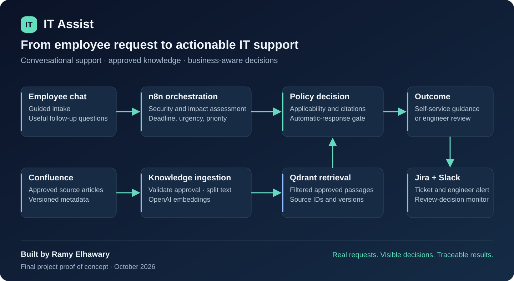

# IT Assist · AI-Assisted IT Service Desk

**Conversational employee support, grounded in approved knowledge and governed by explicit workflow rules.**

Built by **Ramy Elhawary** as a completed final-project proof of concept, October 2026.



An employee describes a technical issue in a guided chat. The system collects useful context, checks for security concerns, assesses business impact, retrieves approved knowledge, and either provides eligible self-service guidance or prepares a cited draft for an engineer. Jira records the request; Slack keeps the IT team informed.

**[Architecture](docs/architecture.md) · [Setup guide](docs/setup.md) · [Demo cases](docs/demo.md) · [Verification](docs/verification.md)**

## The business problem

Service desks spend time collecting missing details, judging urgency from incomplete requests, and searching for relevant guidance. Sending every AI answer for manual approval would introduce another queue; sending every answer automatically would ignore the risk and business context.

This project makes that decision explicit. A routine page-zoom issue can receive approved self-service guidance. A single employee blocked from submitting payroll for 500 people receives P1 treatment because of the business consequences. Unrequested MFA prompts follow the security-review path.

These are demonstrated behaviors. The project does **not** claim measured cost savings or a production deployment.

## What the project demonstrates

| Capability | Implementation |
| --- | --- |
| Guided employee conversation | Custom HTML/CSS/JavaScript frontend and a Python adapter for n8n forms; review before submission and contextual follow-up questions |
| AI triage | Structured category, summary, security evidence, and missing-information assessment |
| Business-aware priority | Explicit impact × urgency rules; deadline anchoring and an adequate-workaround exception for routine requests |
| Governed RAG | Confluence article ingestion, approval validation, text splitting, OpenAI embeddings, and filtered Qdrant retrieval |
| Cited support drafts | Applicability checks and references containing article ID, source URL, and version |
| Selective self-service | Only eligible low-impact, low-urgency requests with supported, approved, automation-permitted knowledge |
| Engineer handoff | Jira ticket with context, priority, draft, and sources; Slack notification |
| Security escalation | Reported or ambiguous security concerns receive specialist review rather than routine troubleshooting |
| Safe no-match behavior | Technician assessment when knowledge does not support the request |
| Repeated-submission protection | Normalized request fingerprint checked against Jira within a 30-minute window |
| Technician review tracking | Scheduled checks for approval/rejection, current-state revalidation, Slack notification, and a notification marker |

## Technology stack

| Layer | Technology |
| --- | --- |
| Employee experience | HTML, CSS, vanilla JavaScript |
| Local frontend adapter | Python standard library |
| Workflow orchestration | n8n running locally in Docker |
| Language models and embeddings | OpenAI through n8n nodes |
| Knowledge authoring | Confluence |
| Vector retrieval | Qdrant |
| Ticket system | Jira Cloud |
| Engineer communication | Slack |
| Narrated demonstration | Synthesia with authentic project recordings |

## Three workflows

1. **[01 · AI Service Desk](workflows/01-ai-service-desk.json)** — intake, duplicate check, triage, clarification, priority, retrieval, drafting, delivery decision, and employee response.
2. **[02 · Knowledge Ingestion](workflows/02-knowledge-ingestion.json)** — fetch Confluence pages, validate article metadata, remove earlier chunks for each processed page, and index eligible content.
3. **[03 · Technician Review Monitor](workflows/03-technician-review-monitor.json)** — check reviewed Jira tickets, recheck their current labels, send the review decision to Slack, and mark it notified.

The exports are sanitized templates. Credentials, account identifiers, live service addresses, and execution data are removed or replaced. All workflows are distributed inactive; configure them before enabling any trigger.

The author confirmed on 18 October that the supplied exports match the Docker workflows. [Export provenance](docs/export-provenance.json) records their source hashes and publication changes. See the [frontend connection checklist](docs/frontend-connection.md) when setting up employee completion pages.

## Reproduce the demonstration

1. Follow the **[setup guide](docs/setup.md)** to configure n8n, Jira, Slack, Confluence, and Qdrant.
2. Import the three workflow JSON files and connect your own credentials.
3. Add the two sample knowledge articles and run knowledge ingestion.
4. Configure and start the frontend:

   ```sh
   cp frontend/config.example.json frontend/config.json
   # Edit frontend/config.json with your imported workflow's form URL and Jira site.
   python3 frontend/server.py
   ```

5. Open **http://localhost:5680** and use the **[fictional demo requests](examples/demo-requests.json)**.

The frontend has no additional Python package dependencies. OpenAI and connected services have their own account requirements and usage costs. See the setup guide for the reference n8n version and the import checklist.

## Demonstrated journeys

| Request | Demonstrated result |
| --- | --- |
| Accidental Microsoft Edge page zoom | P4, cited KB-002 guidance, Jira record, no per-request technician approval |
| VPN failure blocking payroll | P1 / Highest, KB-001-backed draft, engineer review, Jira and Slack handoff |
| Repeated unrequested MFA prompts | Security-review route; no claim that compromise is confirmed |
| Issue without applicable knowledge | No speculative instructions; technician handoff |
| Identical resubmission | Existing ticket reference returned instead of another ticket |
| Technician rejects an AI draft | Review decision notified in Slack and marked to suppress repeated notification |
| Knowledge ingestion | Approved source metadata retained with each stored passage |

See **[demo coverage and evidence](docs/demo.md)** for the distinction between recorded demonstrations, automated checks, and production readiness.

## Run the local checks

```sh
python3 -m unittest discover -s frontend -p 'test_*.py' -v
python3 scripts/validate_repository.py
```

The adapter tests simulate n8n responses. Repository validation checks workflow integrity and publication hygiene. Neither test command calls OpenAI, creates a Jira issue, or sends a Slack message.

## Design choices

- **AI extracts and drafts; workflow rules govern routing and delivery.** Priority calculation and the automatic-response gate remain inspectable expressions.
- **Knowledge approval and automatic delivery are separate decisions.** KB-001 permits a reviewed draft; KB-002 demonstrates restricted self-service.
- **Reported facts stay separate from conclusions.** An access error alone is not evidence of compromise. Guidance delivered is not resolution confirmed.
- **A local deployment keeps the demonstration practical.** The frontend binds to loopback and keeps n8n authentication in place; this is not an internet-facing employee portal.

## Repository contents

```text
frontend/       Employee chat, local adapter, and isolated tests
workflows/      Three sanitized n8n workflow exports
knowledge/      Demo knowledge articles and metadata template
prompts/        Extracted triage, impact, and resolution prompts and schemas
examples/       Fictional requests for the demonstrated routes
docs/           Architecture, deployment, decisions, and demo evidence
scripts/        Repository validation
.github/        Automated validation workflow
compose.yaml    Optional local n8n reference configuration
```

## Author

**Ramy Elhawary** · IT service management, security-conscious automation, and enterprise AI.

This project demonstrates solution design, workflow engineering, integration, RAG governance, business-impact assessment, and evidence-based presentation. Third-party product names belong to their respective owners. See [NOTICE](NOTICE) for reuse information.

