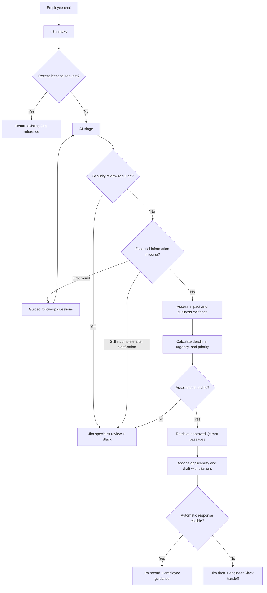
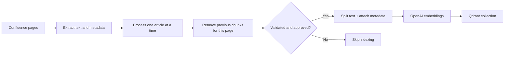
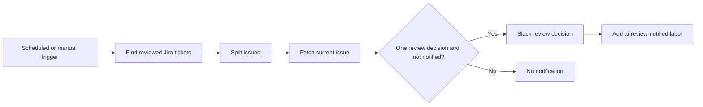

# Architecture and decision flow

## Employee request

The chat adapter uses the existing n8n multi-page form protocol. It does not run another model or independently calculate priority. It returns backend results and hands interactive authentication to n8n.

## Knowledge ingestion

Approval and automatic-response permission are distinct metadata fields. Retrieval filters by the configured space, approved status, and request category. Applicability is then assessed against the actual symptoms and article scope. Similarity alone does not authorize a response.

For a processed page, removing older chunks before inserting its current version avoids accumulating that page's old versions. The demonstration is not a full lifecycle synchronization service: deleted/unfetched Confluence pages and partial failures require additional operational handling.

## Technician review monitor

An empty Jira search result produces no issue items, so downstream nodes need not run. That is an expected no-work result. Review approval/rejection concerns the AI guidance; neither action proves the employee's issue is resolved.

## Priority policy

| Impact \ Urgency | High | Medium | Low |
| --- | --- | --- | --- |
| High | P1 | P2 | P3 |
| Medium | P2 | P3 | P4 |
| Low | P3 | P4 | P4 |

The MVP maps these to Jira Highest, High, Medium, and Low after valid evidence is available. A single affected user can still have high business impact. The workflow does not assign priority from seniority.

Relative deadlines are anchored to the reported submission or clarification timestamp. Unsupported/ambiguous time expressions require review unless the explicit routine-workaround exception applies. Low impact, an adequate workaround, no reported current harm, and no justified business deadline can support low urgency without inventing an exact time for “Today.”

## Automatic-response gate

Automatic delivery requires a calculated P4 with low impact and urgency, no reported security concern or unresolved triage questions, applicable knowledge, approved passages explicitly permitting automatic responses, and citations matching supplied article metadata. Otherwise the draft goes to review.

The gate is a deterministic policy check. It does not prove that every generated sentence is correct. The demo limits self-service to a narrow approved case and keeps the ticket open until the outcome is confirmed.

